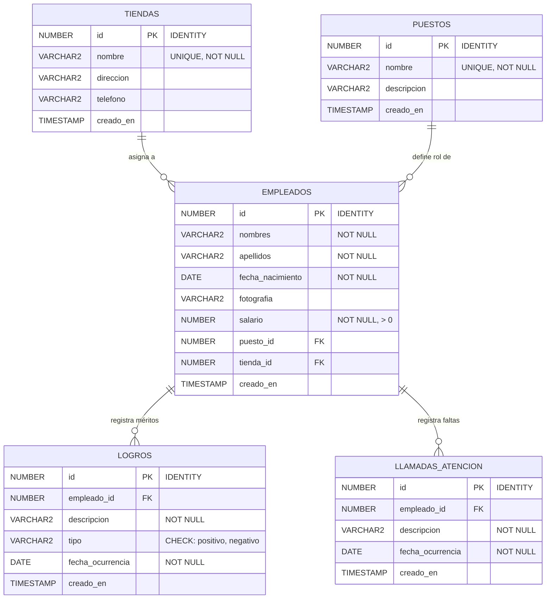

# 🏢 Sistema de Gestión de Personal "Sterenfix"

[](https://cakephp.org)
[](https://www.php.net/)
[](https://www.oracle.com/database/)
[](https://www.docker.com/)
[](https://getbootstrap.com/)

Sistema web integral de administración de capital humano, kárdex laboral 360°, control de nómina y seguimiento disciplinario diseñado para la empresa de tecnología **Sterenfix**.

---

## 📐 Arquitectura de la Solución

La aplicación está construida siguiendo los estándares de la industria bajo una estricta arquitectura **MVC / N-Capas**:

* **Capa de Presentación (View & Templates):** Vistas modulares desarrolladas con Bootstrap 5.3, iconografía de Bootstrap Icons y FontAwesome 6, alertas interactivas mediante SweetAlert2 y visualizador fotográfico modal.
* **Capa de Controladores (Thin Controllers):** Controladores delgados encargados únicamente del flujo HTTP, validación de peticiones, subida segura de fotografías y coordinación con los modelos.
* **Capa de Modelo y Negocio (Fat Models / Table & Entity):** Reglas de negocio encapsuladas en `Table` (validaciones de tipos MIME, restricciones monetarias `salario > 0`, verificación de llaves foráneas con `buildRules`) y entidades con propiedades virtuales (`nombre_completo`, `edad` calculada en tiempo de ejecución, `salario_formateado`, `fotografia_url`).
* **Capa de Base de Datos:** Motor relacional empresarial **Oracle Database 23c / Free**, empleando identificadores autoincrementales nativos (`IDENTITY`), restricciones de integridad referencial (`FOREIGN KEY ON DELETE CASCADE`), llaves únicas y disparadores de auditoría temporal (`TIMESTAMP`).
* **Capa de Contenedores:** Aislamiento total mediante **Docker** y **Docker Compose**, con imagen basada en `php:8.2-apache` compilada con Oracle Instant Client 21.x (`oci8` y `pdo_oci`) y extensiones PHP esenciales (`intl`, `mbstring`, `gd`, `zip`).

---

## 🗄️ Modelo de Datos en Oracle Database

El esquema relacional incluye 5 tablas principales optimizadas con índices:



---

## 🚀 Requisitos Previos

Antes de ejecutar el proyecto, asegúrese de tener instalado:
* **Docker** (v20.10 o superior) y **Docker Compose** (v2.x o superior) o **Podman** con `podman-compose`.
* **Git** (v2.x).

---

## 🛠️ Instalación y Puesta en Marcha

Siga estos pasos para clonar, configurar y desplegar el sistema localmente:

### 1. Clonar el Repositorio
```bash
git clone https://github.com/Snayersh/Cakephp.git
cd Cakephp
```

### 2. Configurar el Archivo de Entorno (`.env`)
Copie el archivo de ejemplo y ajuste las credenciales según su entorno si es necesario:
```bash
cp .env.example .env
```

### 3. Levantar los Contenedores con Docker Compose
Inicie la base de datos Oracle y el servidor web Apache + PHP 8.2 en segundo plano:
```bash
docker compose up -d --build
```
*(Si utiliza Podman en Linux Fedora/RHEL, ejecute `podman-compose up -d --build`)*.

### 4. Inicialización Automática de Base de Datos y Seeds
El contenedor de Oracle (`sterenfix_db`) inicializa automáticamente el usuario, permisos, tablas e inserta los datos precargados (`seeds.sql`) mediante el volumen montado en `/docker-entrypoint-initdb.d/setup/01_init.sql`.

Si desea reaplicar manualmente los scripts dentro del contenedor de Oracle en cualquier momento, puede ejecutar:
```bash
docker exec -i sterenfix_db sqlplus sys/SterenfixPassword123#@//localhost:1521/FREEPDB1 as sysdba < database/init.sql
```

### 5. Acceder a la Aplicación
Abra su navegador web y navegue a:
```text
http://localhost:8080
```

---

## 🔑 Credenciales por Defecto

| Parámetro | Valor por Defecto |
| :--- | :--- |
| **URL del Sistema** | `http://localhost:8080` |
| **Motor de Base de Datos** | Oracle Database Free 23c / 19c |
| **Host Interno DB** | `sterenfix_db` (o `localhost` en puerto `1521`) |
| **Puerto DB** | `1521` |
| **Pluggable Database (PDB)** | `FREEPDB1` |
| **Usuario DB de Aplicación** | `sterenfix` |
| **Contraseña DB de Aplicación**| `SterenfixPassword123#` |
| **Usuario Administrador SYS**| `SYS` / `SterenfixPassword123#` |

---

## 📊 Módulos y Reportes del Sistema

### 1. Panel de Control Ejecutivo (Dashboard)
* Vista consolidada con métricas en tiempo real: total de colaboradores, sucursales activas, gasto total en nómina, promedio salarial y balance de disciplina.
* Gráfico interactivo con **Chart.js** comparando el presupuesto de nómina asignado por cada tienda.
* Listados rápidos de últimos empleados registrados y bitácora reciente de logros y amonestaciones.

### 2. Catálogos Base (Tiendas y Puestos)
* Operaciones CRUD completas para Sucursales y Puestos laborales.
* Validación estricta de nombres únicos y protección de integridad referencial al eliminar.

### 3. Gestión de Empleados y Perfil 360° (Kárdex)
* Formulario con separación estricta de nombres y apellidos, selector de fecha para nacimiento, control monetario para salario con validación mayor a cero.
* Subida de fotografía con validación de tipo MIME (JPG, PNG, WEBP), tamaño máximo de 5MB y previsualizador en vivo.
* **Perfil 360° del Empleado (Kárdex):**
  - Fotografía en alta resolución con ampliador modal.
  - Indicadores clave: edad calculada, proyección de salario anual y quincenal.
  - Pestañas con datos personales, historial cronológico de logros (con insignias verdes para positivos y rojas para negativos) y registro disciplinario de llamadas de atención.
  - Accesos directos para registrar nuevos méritos o sanciones directamente desde el expediente.

### 4. Informes y Reportes Especializados
1. **Reporte General de Empleados:**
   - Tabla interactiva con miniaturas ampliables, nombres, apellidos, fecha de nacimiento, edad, puesto, tienda y salario formateado en moneda.
   - **Totalización General de Salarios** destacada en tarjeta superior y en el pie de tabla.
2. **Reporte de Salarios de Empleados por Tienda:**
   - Agrupación visual organizada por tienda.
   - Ordenamiento estricto de empleados por salario **de mayor a menor**.
   - **Subtotales de salarios calculados por cada tienda** y comparativa porcentual sobre el presupuesto global.
3. **Reporte General de Logros:**
   - Filtrado dinámico por empleado, rango de fechas y tipo (Positivo / Negativo) con insignias de color.
   - Métricas de balance y porcentaje de cumplimiento operativo.
4. **Reporte de Llamadas de Atención:**
   - Registro cronológico detallado de incidencias y amonestaciones por tienda y colaborador.
   - Optimizado para impresión ejecutiva o exportación a PDF vía navegador (`Ctrl + P`).

---

## 📦 Estructura del Proyecto

```text
├── bin/                       # Ejecutables de consola de CakePHP
├── config/                    # Configuración central (app.php, routes.php, bootstrap.php)
├── database/                  # Scripts DDL y DML para Oracle Database
│   ├── init.sql               # Script de aprovisionamiento de usuario y esquema
│   ├── schema.sql             # Definición de tablas, restricciones e índices
│   └── seeds.sql              # Datos precargados realistas (tiendas, puestos, empleados)
├── docker/                    # Archivos auxiliares de Docker
│   └── entrypoint.sh          # Script de arranque y permisos para el contenedor
├── src/                       # Código fuente PHP
│   ├── Controller/            # Controladores delgados (Dashboard, Empleados, Reportes...)
│   ├── Model/
│   │   ├── Entity/            # Entidades de dominio con propiedades virtuales
│   │   └── Table/             # Modelos Table con validaciones y reglas de negocio
│   └── View/                  # Clases base de vistas
├── templates/                 # Plantillas modulares de presentación
│   ├── element/               # Componentes reutilizables (sidebar, navbar, flash)
│   ├── layout/                # Layout maestro corporativo con Bootstrap 5 y SweetAlert2
│   ├── Dashboard/             # Tablero principal de métricas y gráficos
│   ├── Empleados/             # Listados, formularios y Perfil 360° (Kárdex)
│   ├── Tiendas/               # Gestión de sucursales
│   ├── Puestos/               # Gestión de puestos
│   ├── Logros/                # Registro de logros
│   ├── LlamadasAtencion/      # Registro disciplinario
│   └── Reportes/              # 4 Reportes ejecutivos especializados
├── webroot/                   # Directorio público web (assets compilados, imágenes)
│   ├── css/app.css            # Estilos personalizados y reglas para impresión
│   ├── js/app.js              # Lógica interactiva de SweetAlert2 y modales
│   └── img/empleados/         # Almacenamiento seguro de fotografías de empleados
├── .env.example               # Plantilla de variables de entorno seguras
├── .gitignore                 # Reglas de exclusión para Git y CakePHP
├── docker-compose.yml         # Orquestación de servicios app y db
├── Dockerfile                 # Definición de contenedor PHP 8.2 + Oracle Instant Client
├── composer.json              # Dependencias de paquetes PHP
└── README.md                  # Documentación técnica
```

---

## 🐙 Comandos Git para Despliegue en Repositorio

Para inicializar y enviar el proyecto a su repositorio en GitHub (`https://github.com/Snayersh/Cakephp.git`):

```bash
# 1. Inicializar repositorio local
git init

# 2. Configurar rama principal main
git branch -M main

# 3. Vincular con el repositorio remoto
git remote add origin https://github.com/Snayersh/Cakephp.git

# 4. Agregar todos los archivos fuente (respetando .gitignore)
git add .

# 5. Crear el commit inicial estructurado
git commit -m "feat: implementacion inicial del sistema de gestion de personal sterenfix con cakephp y oracle database"

# 6. Enviar cambios a la rama main remota
git push -u origin main
```

---

## 📄 Licencia y Créditos

Desarrollado para **Sterenfix Tecnología**. Todos los derechos reservados.
