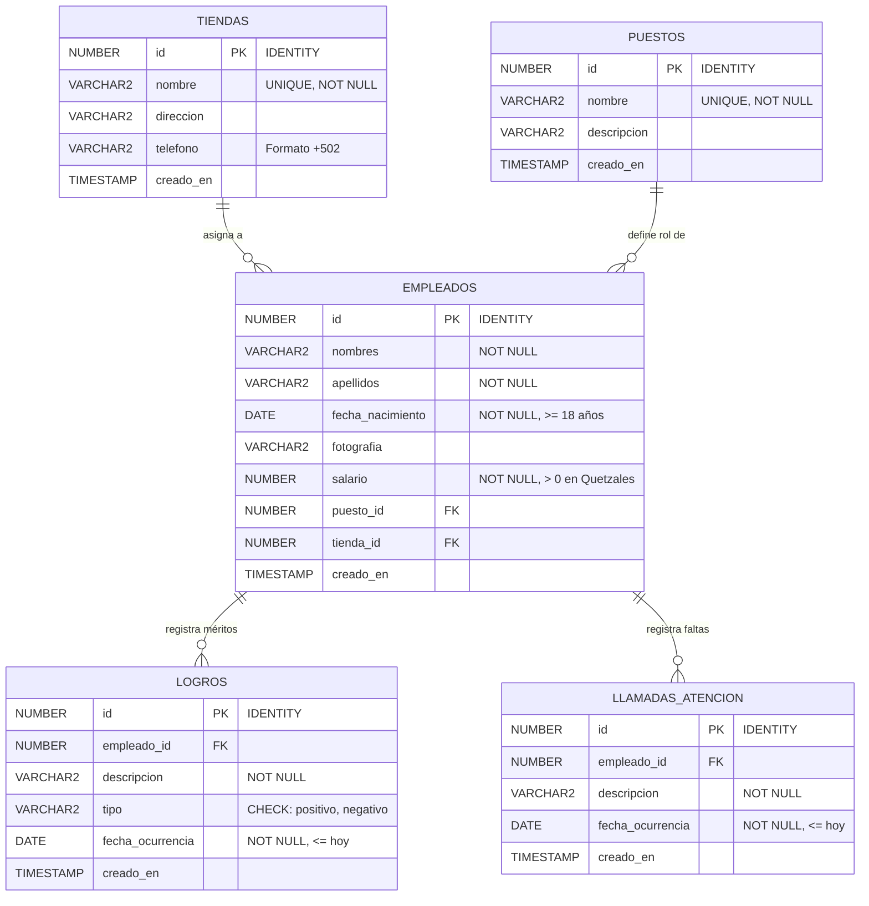

# 🏢 Sistema de Gestión de Personal "Sterenfix"

[](https://cakephp.org)
[](https://www.php.net/)
[](https://www.oracle.com/database/)
[](https://www.docker.com/)
[](https://podman.io/)
[](https://getbootstrap.com/)
[](https://sweetalert2.github.io/)
[](tests/system_test_runner.php)

Sistema web integral de administración de capital humano, kárdex laboral 360°, control de nómina y seguimiento disciplinario diseñado a medida para la empresa de tecnología **Sterenfix**.

---

## 📐 Arquitectura de la Solución

La aplicación está construida siguiendo los más rigurosos estándares de la industria bajo una arquitectura **MVC / N-Capas**:

* **Capa de Presentación (View & Templates):** Vistas modulares y responsivas desarrolladas con Bootstrap 5.3, iconografía de Bootstrap Icons y FontAwesome 6, interactividad moderna con **Tom Select** (autocompletado y búsqueda en vivo en dropdowns), alertas y diálogos de confirmación mediante **SweetAlert2** y visualizador fotográfico modal.
* **Capa de Controladores (Thin Controllers):** Controladores delgados encargados estrictamente del flujo HTTP, validación de peticiones, subida segura de fotografías y coordinación con los modelos.
* **Capa de Modelo y Negocio (Fat Models / Table & Entity):** Reglas de negocio encapsuladas en `Table` (validaciones de tipos MIME, restricciones monetarias en **Quetzales** con `salario > 0`, verificación de teléfonos de Guatemala de 8 dígitos con prefijo `+502`, límites de fechas y verificación de integridad referencial mediante `buildRules`) y entidades con propiedades virtuales (`nombre_completo`, `edad` calculada en tiempo de ejecución, `salario_formateado` en `Q`, `fotografia_url`).
* **Capa de Base de Datos & Driver OCI:** Motor relacional empresarial **Oracle Database 23c / Free** (PDB `FREEPDB1`), empleando identificadores autoincrementales nativos (`IDENTITY`), restricciones de integridad referencial (`FOREIGN KEY ON DELETE CASCADE`), llaves únicas y disparadores de auditoría temporal (`TIMESTAMP`). Incorpora un **Driver Nativo de Oracle para CakePHP 4.5** personalizado para sincronización de secuencias, paginación ANSI y codificación UTF-8.
* **Capa de Contenedores:** Aislamiento total mediante **Docker / Podman** y **Docker Compose**, con imagen basada en `php:8.2-apache` compilada con Oracle Instant Client 21.x (`oci8` y `pdo_oci`) y extensiones PHP esenciales (`intl`, `mbstring`, `gd`, `zip`).

---

## 🇬🇹 Localización y Reglas de Negocio Regionales

* **Moneda Oficial en Quetzales (Q / GTQ):**
  - Todos los importes monetarios del sistema (salarios individuales, presupuestos departamentales, nómina total, subtotales por tienda y proyecciones quincenales/anuales) están expresados y formateados estrictamente en **Quetzales guatemaltecos (`Q`)**.
  - Configuración regional de sesión NLS (`SPANISH`, `GUATEMALA`, separador decimal `.` y de miles `,`).
* **Formato Telefónico de Guatemala (+502):**
  - Validación estricta para números de teléfono de 8 dígitos de Guatemala.
  - Normalización automática al estándar internacional `+502 XXXX XXXX` al guardar o actualizar sucursales.
* **Control Estricto de Fechas:**
  - **Fecha de Nacimiento:** Bloqueada tanto a nivel HTML como en reglas del modelo para requerir mayoría de edad (mínimo 18 años cumplidos). No permite fechas futuras ni menores de edad.
  - **Fecha de Ocurrencia:** Bloqueada para que los logros y llamadas de atención no puedan registrarse con fechas futuras posteriores al día actual (`<= hoy`).

---

## 🗄️ Modelo de Datos en Oracle Database

El esquema relacional incluye 5 tablas principales optimizadas con índices y restricciones:



---

## 🚀 Requisitos Previos

Antes de ejecutar el proyecto, asegúrese de tener instalado:
* **Docker** (v20.10 o superior) y **Docker Compose** (v2.x o superior) o **Podman** con `podman-compose`.
* **Git** (v2.x).

---

## 🛠️ Instalación y Puesta en Marcha

Siga estos pasos para clonar, configurar y desplegar el sistema localmente:

### 1. Clonar el Repositorio
```bash
git clone https://github.com/Snayersh/Cakephp.git
cd Cakephp
```

### 2. Configurar el Archivo de Entorno (`.env`)
Copie el archivo de ejemplo y ajuste las credenciales según su entorno si es necesario:
```bash
cp .env.example .env
```

### 3. Levantar los Contenedores con Docker Compose
Inicie la base de datos Oracle y el servidor web Apache + PHP 8.2 en segundo plano:
```bash
# Con Docker Compose
docker compose up -d --build

# O con Podman Compose en Linux Fedora / RHEL
podman-compose up -d --build
```

### 4. Inicialización Automática de Base de Datos y Seeds
El contenedor de Oracle inicializa automáticamente el usuario, permisos, tablas e inserta los datos precargados (`seeds.sql`) mediante el volumen montado en `/docker-entrypoint-initdb.d/setup/01_init.sql`.

Si desea reaplicar manualmente los scripts dentro del contenedor de Oracle en cualquier momento, puede ejecutar:
```bash
# Con Docker
docker exec -i oracle-db sqlplus sys/SterenfixPassword123#@//localhost:1521/FREEPDB1 as sysdba < database/init.sql

# Con Podman
podman exec -i oracle-db sqlplus sys/SterenfixPassword123#@//localhost:1521/FREEPDB1 as sysdba < database/init.sql
```

### 5. Acceder a la Aplicación
Abra su navegador web y navegue a:
```text
http://localhost:8080
```

---

## 🔑 Credenciales por Defecto

| Parámetro | Valor por Defecto |
| :--- | :--- |
| **URL del Sistema** | `http://localhost:8080` |
| **Motor de Base de Datos** | Oracle Database Free 23c / 19c |
| **Host Interno DB** | `oracle-db` / `sterenfix_db` (o `localhost` en puerto `1521`) |
| **Puerto DB** | `1521` |
| **Pluggable Database (PDB)** | `FREEPDB1` |
| **Usuario DB de Aplicación** | `sterenfix` |
| **Contraseña DB de Aplicación**| `SterenfixPassword123#` |
| **Usuario Administrador SYS**| `SYS` / `SterenfixPassword123#` |

---

## 🧪 Pruebas Automatizadas E2E (Test Suite Autónomo)

El proyecto incluye un ejecutor de pruebas automatizado de extremo a extremo (E2E) que valida el 100% de los flujos del sistema sin dependencias externas:

```bash
# Ejecutar con Podman
podman exec -it sterenfix_web php tests/system_test_runner.php

# O ejecutar con Docker
docker exec -it sterenfix_web php tests/system_test_runner.php
```

### Cobertura de las 31 Pruebas Automatizadas (31/31 PASS):
1. **Infraestructura:** Verificación de cabeceras HTTP 200, UTF-8 y versión PHP 8.2.
2. **Dashboard y Moneda:** Despliegue de métricas salariales en Quetzales (`Q`), gráficos de nómina y widgets.
3. **Módulo Tiendas (CRUD):** Creación, lectura, edición, validación de teléfono (+502) y borrado en Oracle.
4. **Módulo Puestos (CRUD):** Creación, consulta de detalle y eliminación.
5. **Módulo Personal y Kárdex:** Validación de salarios positivos en Quetzales, rechazo de valores negativos, registro con foto, vistas 360° y cálculo de edad.
6. **Logros y Llamadas de Atención:** Registro de méritos positivos/negativos y actas disciplinarias.
7. **Reportes y Totales:** Totalización general en Quetzales (`Q`), cálculo de subtotales por tienda y balance disciplinario.
8. **Codificación:** Integridad de caracteres UTF-8 (tildes, eñes y caracteres especiales) sin corrupción.

---

## 🎨 Características de Interfaz y Experiencia de Usuario (UI/UX)

* **Dropdowns con Búsqueda Inteligente (Tom Select):**
  Todos los selectores del sistema (Tiendas, Puestos, Empleados y Tipos) cuentan con autocompletado en vivo. Permite escribir el nombre para encontrarlo al instante o desplegar la lista completa con un solo clic.
* **Filtrado Dinámico en Tiempo Real (Debounced Search):**
  Los formularios de búsqueda y filtrado de reportes responden en vivo mientras se escribe o selecciona un parámetro, sin necesidad obligatoria de pulsar el botón "Filtrar".
* **Confirmación de Eliminación con SweetAlert2:**
  Las acciones destructivas (eliminar sucursales, puestos, colaboradores o actas) interceptan el evento de envío para mostrar un modal elegante de confirmación interactiva, impidiendo eliminaciones accidentales.
* **Subida y Previsualización de Fotografías:**
  Validación estricta de extensiones (JPG, PNG, WEBP), tamaño máximo de 5MB y previsualizador dinámico instantáneo antes de guardar.
* **Diseño Responsivo e Impresión Ejecutiva:**
  Compatible con dispositivos móviles y optimizado con estilos `@media print` para exportación directa a PDF (`Ctrl + P`).

---

## 📊 Módulos y Reportes del Sistema

### 1. Panel de Control Ejecutivo (Dashboard)
* Vista consolidada con métricas en tiempo real: total de colaboradores, sucursales activas, gasto total en nómina (en Quetzales `Q`), promedio salarial y balance de disciplina.
* Gráfico interactivo con **Chart.js** comparando la distribución del presupuesto de nómina asignado por cada tienda.
* Listados rápidos de últimos colaboradores registrados y bitácora reciente de logros y amonestaciones con acceso directo al Kárdex.

### 2. Catálogos Base (Tiendas y Puestos)
* Operaciones CRUD completas para Sucursales y Puestos laborales.
* Validación estricta de nombres únicos y números de teléfono guatemaltecos (`+502`).
* Protección de integridad referencial al eliminar registros vinculados.

### 3. Gestión de Empleados y Perfil 360° (Kárdex)
* Formulario con separación estricta de nombres y apellidos, selector de fecha de nacimiento (mínimo 18 años), control monetario para salario con validación mayor a cero.
* Subida de fotografía con previsualización en vivo y validación de tipo MIME.
* **Perfil 360° del Empleado (Kárdex):**
  - Fotografía en alta resolución con ampliador modal interactivo.
  - Indicadores clave: edad calculada dinámicamente, proyección de salario quincenal y anual en Quetzales.
  - Pestañas modulares con datos personales, historial cronológico de logros (con insignias de color) y registro disciplinario de llamadas de atención.
  - Accesos directos para registrar nuevos méritos o sanciones directamente desde el expediente.

### 4. Informes y Reportes Especializados
1. **Reporte General de Empleados:**
   - Tabla interactiva con miniaturas ampliables, nombres, apellidos, fecha de nacimiento, edad, puesto, tienda y salario formateado en **Quetzales (`Q`)**.
   - **Totalización General de Salarios** destacada en tarjeta superior y en el pie de tabla.
2. **Reporte de Salarios de Empleados por Tienda:**
   - Agrupación visual organizada por tienda.
   - Ordenamiento estricto de empleados por salario **de mayor a menor**.
   - **Subtotales de salarios calculados por cada tienda** y comparativa porcentual sobre el presupuesto global.
3. **Reporte General de Logros:**
   - Filtrado dinámico por empleado, rango de fechas y tipo (Positivo / Negativo) con insignias de color.
   - Métricas de balance y porcentaje de cumplimiento operativo.
4. **Reporte de Llamadas de Atención:**
   - Registro cronológico detallado de incidencias y amonestaciones por tienda y colaborador.
   - Optimizado para impresión ejecutiva o exportación a PDF vía navegador (`Ctrl + P`).

---

## 🔧 Driver Nativo de Oracle Database para CakePHP 4.5

Debido a que CakePHP 4.5 no incluye soporte nativo por defecto para Oracle Database 23c, se diseñó e implementó una capa arquitectónica personalizada de persistencia en `src/Database/`:

* **`src/Database/Driver/Oracle.php`:**
  - Conexión PDO OCI con configuración automática de variables de sesión Oracle NLS (`NLS_LANGUAGE=SPANISH`, `NLS_TERRITORY=GUATEMALA`, `NLS_NUMERIC_CHARACTERS='.,'`).
  - Detección de identificadores autoincrementales (`IDENTITY`) y obtención de último ID insertado.
* **`src/Database/OracleCompiler.php`:**
  - Traducción de consultas CakePHP QueryBuilder a sintaxis compatible con Oracle 23c.
  - Soporte de paginación moderna mediante cláusulas `OFFSET ... ROWS FETCH NEXT ... ROWS ONLY`.
  - Tratamiento adecuado de comillas e identificadores de campos reservados.
* **`src/Database/Statement/OracleStatement.php`:**
  - Decorador de sentencias preparadas con buffer para sentencias no-SELECT, previniendo errores de cursor OCI durante operaciones de escritura e inserción.

---

## 📦 Estructura del Proyecto

```text
├── bin/                             # Ejecutables de consola de CakePHP
├── config/                          # Configuración central (app.php, routes.php, bootstrap.php)
├── database/                        # Scripts DDL y DML para Oracle Database
│   ├── init.sql                     # Script de aprovisionamiento de usuario y esquema
│   ├── schema.sql                   # Definición de tablas, restricciones e índices
│   └── seeds.sql                    # Datos precargados realistas (tiendas, puestos, empleados)
├── docker/                          # Archivos auxiliares de Docker
│   └── entrypoint.sh                # Script de arranque y permisos para el contenedor
├── src/                             # Código fuente PHP
│   ├── Controller/                  # Controladores delgados (Dashboard, Empleados, Reportes...)
│   ├── Database/                    # Driver y compilador nativo de Oracle Database 23c
│   │   ├── Driver/Oracle.php        # Driver PDO OCI personalizado
│   │   ├── OracleCompiler.php       # Compilador SQL con soporte OFFSET/FETCH y NLS
│   │   └── Statement/
│   │       └── OracleStatement.php  # Decorador de cursor y buffer OCI
│   ├── Model/
│   │   ├── Entity/                  # Entidades de dominio con propiedades virtuales (Quetzales, edad)
│   │   └── Table/                   # Modelos Table con validaciones y reglas de negocio
│   └── View/                        # Clases base de vistas
├── templates/                       # Plantillas modulares de presentación
│   ├── element/                     # Componentes reutilizables (sidebar, navbar, flash)
│   ├── layout/                      # Layout maestro corporativo con Bootstrap 5 y SweetAlert2
│   ├── Dashboard/                   # Tablero principal de métricas y gráficos
│   ├── Empleados/                   # Listados, formularios y Perfil 360° (Kárdex)
│   ├── Tiendas/                     # Gestión de sucursales
│   ├── Puestos/                     # Gestión de puestos
│   ├── Logros/                      # Registro de logros
│   ├── LlamadasAtencion/            # Registro disciplinario
│   └── Reportes/                    # 4 Reportes ejecutivos especializados
├── tests/                           # Suite de pruebas automatizadas
│   └── system_test_runner.php       # Runner E2E con 31 pruebas autónomas
├── webroot/                         # Directorio público web
│   ├── css/
│   │   ├── app.css                  # Estilos personalizados y reglas para impresión
│   │   └── tom-select.bootstrap5.min.css # Estilos de combobox inteligente
│   ├── js/
│   │   ├── app.js                   # Lógica de SweetAlert2, filtros reactivos y modales
│   │   └── tom-select.complete.min.js    # Librería de autocompletado y búsqueda en vivo
│   └── img/empleados/               # Almacenamiento de fotografías de empleados
├── .env.example                     # Plantilla de variables de entorno seguras
├── .gitignore                       # Reglas de exclusión para Git y CakePHP
├── docker-compose.yml               # Orquestación de servicios app y db
├── Dockerfile                       # Definición de contenedor PHP 8.2 + Oracle Instant Client
├── composer.json                    # Dependencias de paquetes PHP
└── README.md                        # Documentación técnica integral
```

---

## 🐙 Comandos Git para Despliegue en Repositorio

Para sincronizar o actualizar los cambios en el repositorio GitHub (`https://github.com/Snayersh/Cakephp.git`):

```bash
# 1. Verificar estado de los archivos
git status

# 2. Agregar los archivos actualizados
git add .

# 3. Registrar el commit descriptivo
git commit -m "docs: actualizar README con detalles de Quetzales, telefono GT, Tom Select, SweetAlert2 y suite de pruebas E2E"

# 4. Enviar cambios a la rama main remota
git push origin main
```

---

## 📄 Licencia y Créditos

Desarrollado para **Sterenfix Tecnología**. Todos los derechos reservados.
